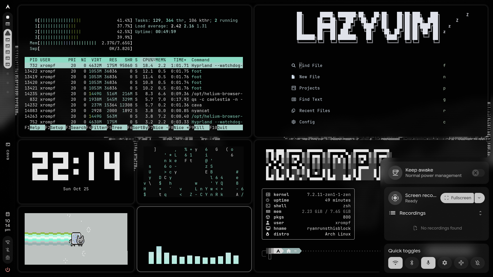

# xrompf-dots

yes i use linux-zen kernel like any true sigma would ofc.
looks easy, but defo took some work, so a feel free to drop a star if your using it!
## Features

- Modded **infinite-desktop-v2** to work on Caelestia 
- Custom **zsh config** with two themes for the ultimate terminal rice
- Tweaked some settings, and removed or remapped shortcuts so the plugins work together

> **Known issue:** the toggleable infinite windows from infinite-desktop-v2 don't fully work yet.

## Installation (manual, automatic wizard coming soon)

### Dependencies
- [Oh My Zsh](https://ohmyz.sh/) `sh -c "$(curl -fsSL https://raw.githubusercontent.com/ohmyzsh/ohmyzsh/master/tools/install.sh)"`
- [Powerlevel10k](https://github.com/romkatv/powerlevel10k) `git clone --depth=1 https://github.com/romkatv/powerlevel10k.git "${ZSH_CUSTOM:-$HOME/.oh-my-zsh/custom}/themes/powerlevel10k"` or `yay -S --noconfirm zsh-theme-powerlevel10k-git
echo 'source /usr/share/zsh-theme-powerlevel10k/powerlevel10k.zsh-theme' >>~/.zshrc `
- [Caelestia](https://github.com/caelestia-dots/shell) (official Hyprland version recommended, other WMs may work) `paru -S caelestia-cli` and `caelestia install` 
- [hyprland-infinitie-desktop-v2 ported to caelestia](https://github.com/xrompf-alt/hyprland-infinitie-desktop-v2.git) ported by me! (manual install from the repo only,sorry)

### Dotfiles

| Copy this file from the repo | To here |
|---|---|
| `fishgreet.fish` | `~/.config/fish/functions/fish_greeting.fish` |
| `zsh config (with omz)/.zshrc` | `~/.zshrc` |
| `zsh config (with omz)/.p10k.zsh` | `~/.p10k.zsh` |
| `caelestia-config (pretty small).json` | `~/.config/caelestia/shell.json` |

Automatic config for astra-airlock (note to self):
`sudo astra-airlock -k hyprland`
Limine plymouth config (also note to self)
Edit `/boot/EFI/BOOT/limine.conf` and add `rw quiet splash` to the kernel command line.

## Credits
- [infinite-desktop-v2](https://github.com/sarodscommits/hyprland-infinitie-desktop-v2) by sarodcommits
- [Caelestia](https://github.com/caelestia-dots) by caelestia-dots
- [Hyprland](https://hyprland.org/)
- [Oh My Zsh](https://github.com/ohmyzsh/ohmyzsh) by the ohmyzsh team
- [Powerlevel10k](https://github.com/romkatv/powerlevel10k) by romkatv
- [zsh](https://www.zsh.org/)
